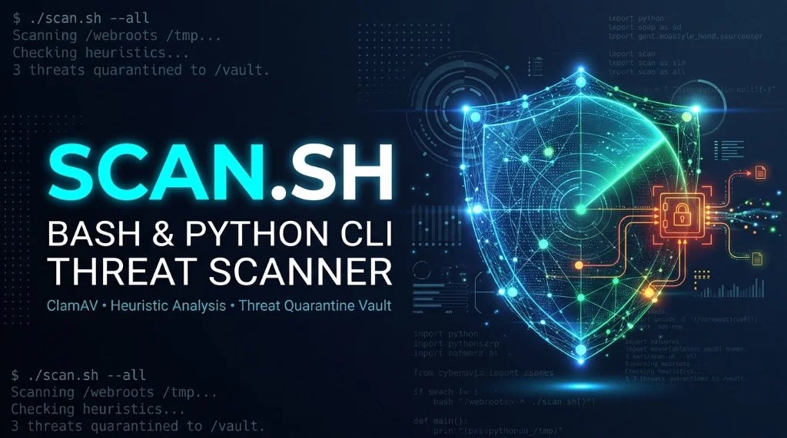

[](README.md) [](README-ptbr.md) [](README-es.md)

# scan



[](https://github.com/sr00t3d/scan/releases/tag/v2.0.0)
[](LICENSE)
[](#requisitos)
[](#requisitos)

**Escáner Híbrido ClamAV + Heurístico de Webshells con Cuarentena Segura Root-Only.**

`scan.sh` analiza cuentas cPanel/Plesk, resellers, webroots, `/tmp` y `/dev/shm` combinando **ClamAV autodetectado** con un **motor heurístico nativo en Python** (EICAR, webshells PHP, ofuscación), ejecutándose en modo solo lectura por defecto con cuarentena `0700` en `/var/quarantine/scan/` y restauración directa con `restore`.

> **Inspiración Histórica:** Reimplementación limpia en Bash + Python 3.6+ (`v2.0.0`) inspirada en `scan_2.sh` (2012, Michael Karr, HostGator.com, LLC).

---

## Ejecución Directa

```bash
curl -fsSL https://raw.githubusercontent.com/sr00t3d/scan/main/scan.sh -o scan.sh
chmod +x scan.sh
sudo ./scan.sh --path /home/percio/public_html --exit-code
```

---

## Ejemplo de Salida Real

```text
==================================================================================================
 scan.sh v2.0.0 | Scan | /tmp/scan-e2e/webroot | heuristic | 2026-11-24T02:39:46Z
==================================================================================================
SEVERITY  ENGINE     SIGNATURE                   ACTION       PATH
--------  ---------  --------------------------  -----------  --------------------------------------------------
CRITICAL  heuristic  PHP.Webshell.UserInputExec  QUARANTINED  /tmp/scan-e2e/webroot/cmd.php
CRITICAL  heuristic  EICAR-Test-Signature        QUARANTINED  /tmp/scan-e2e/webroot/eicar.txt
HIGH      heuristic  PHP.Webshell.EvalBase64     QUARANTINED  /tmp/scan-e2e/webroot/wp-content/uploads/shell.php

Summary: 4 file(s) scanned | 3 threat(s) found
Vault:   /var/quarantine/scan/20261124-023946
```

---

## Licencia

Licenciado bajo [Apache License 2.0](LICENSE).
