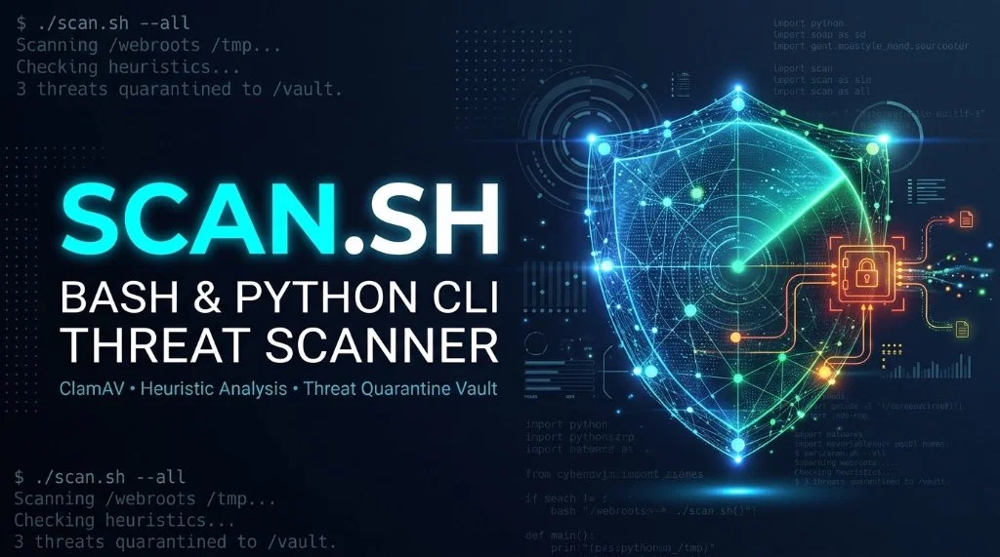

[](README.md) [](README-ptbr.md) [](README-es.md)

# scan



[](https://github.com/sr00t3d/scan/releases/tag/v2.0.0)
[](LICENSE)
[](#requisitos)
[](#requisitos)

**Scanner Híbrido ClamAV + Heurístico de Webshells com Quarentena Segura Root-Only.**

O `scan.sh` varre contas cPanel/Plesk, revendas, webroots, `/tmp` e `/dev/shm` combinando **ClamAV autodetectado** com um **motor heurístico nativo em Python** (sem dependências externas) para detectar EICAR, `eval(base64_decode(...))`, `system($_GET[...])`, `preg_replace /e` e famílias de webshells PHP. Opera em **modo somente-leitura por padrão**, é **symlink-safe** e isola ameaças em cofre root-only `0700` (`/var/quarantine/scan/`) com `manifest.json` SHA-256 e restauração via `restore`.

> **Inspiração Histórica:** Reimplementação limpa em Bash + Python 3.6+ (`v2.0.0`) inspirada no clássico `scan_2.sh` (2012, Michael Karr, HostGator.com, LLC).

---

## Execução Direta

```bash
curl -fsSL https://raw.githubusercontent.com/sr00t3d/scan/main/scan.sh -o scan.sh
chmod +x scan.sh
sudo ./scan.sh --path /home/percio/public_html --exit-code
```

---

## Exemplos de Uso

```bash
sudo ./scan.sh percio --exit-code
sudo ./scan.sh --path /var/www/html --quarantine --dry-run
sudo ./scan.sh --path /var/www/html --quarantine -o json
sudo ./scan.sh restore /var/quarantine/scan/20261123-223500
```

---

## Licença

Distribuído sob a licença [Apache License 2.0](LICENSE).
