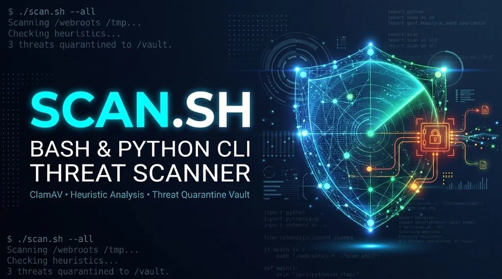

[](README.md) [](README-ptbr.md) [](README-es.md)

# scan



[](https://github.com/sr00t3d/scan/releases/tag/v2.0.0)
[](LICENSE)
[](#requirements)
[](#requirements)

**Hybrid ClamAV + Heuristic Webshell Scanner & Root-Only Quarantine CLI for Linux, cPanel & Plesk.**

`scan.sh` scans hosted accounts, resellers, webroots, `/tmp`, and `/dev/shm` using **auto-detected ClamAV** (`clamdscan`, `clamscan`, or cPanel ClamAV) combined with a **built-in zero-dependency Python heuristic engine** (detecting EICAR, obfuscated `eval(base64_decode(...))`, `system($_GET[...])`, `preg_replace /e`, and classic PHP webshell families). Runs **read-only by default**, is **100% symlink-safe**, and quarantines threats into a root-only `0700` vault (`/var/quarantine/scan/`) with SHA-256 `manifest.json` and one-command `restore`.

> **Historical Inspiration:** Clean-room Bash + Python 3.6+ `v2.0.0` reimplementation inspired by `scan_2.sh` (2012, Michael Karr, HostGator.com, LLC). Eliminates unencrypted HTTP binary downloads (`scripts.hostgator.com`), self-deleting script traps, symlink privilege escalation from writing root files inside `$SCANDIR/.security/`, and duplicated flags in reseller loops.

---

## Requirements

- Linux with Bash 4.0+ and Python 3.6+ (standard library only)
- Optional: ClamAV (`clamscan`, `clamdscan`, or `/usr/local/cpanel/3rdparty/bin/clamscan`) for dual-engine scanning

---

## Direct Execution

```bash
curl -fsSL https://raw.githubusercontent.com/sr00t3d/scan/main/scan.sh -o scan.sh
chmod +x scan.sh
sudo ./scan.sh --path /home/percio/public_html --exit-code
```

---

## Usage

```bash
# 1. Read-only scan of a user account (+ /tmp & /dev/shm files owned by user)
sudo ./scan.sh percio --exit-code

# 2. Scan a webroot directory and preview quarantine moves (--dry-run)
sudo ./scan.sh --path /var/www/html --quarantine --dry-run

# 3. Quarantine detected threats into a root-only 0700 vault with SHA-256 manifest
sudo ./scan.sh --path /var/www/html --quarantine -o json

# 4. Scan all accounts owned by a cPanel reseller
sudo ./scan.sh --reseller myreseller --engine both

# 5. Restore quarantined files cleanly to their original path, mode, and ownership
sudo ./scan.sh restore /var/quarantine/scan/20261123-223500
```

---

## License

Licensed under the [Apache License 2.0](LICENSE).
